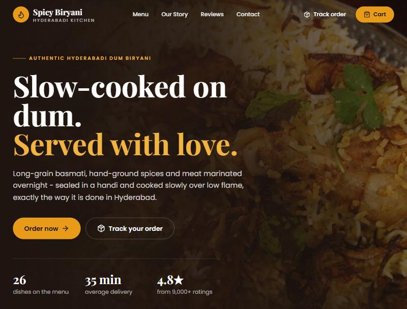
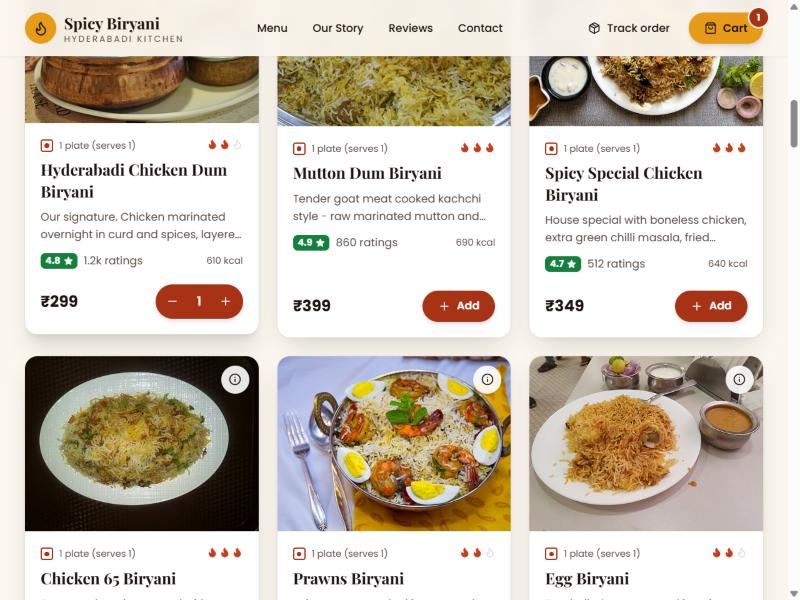
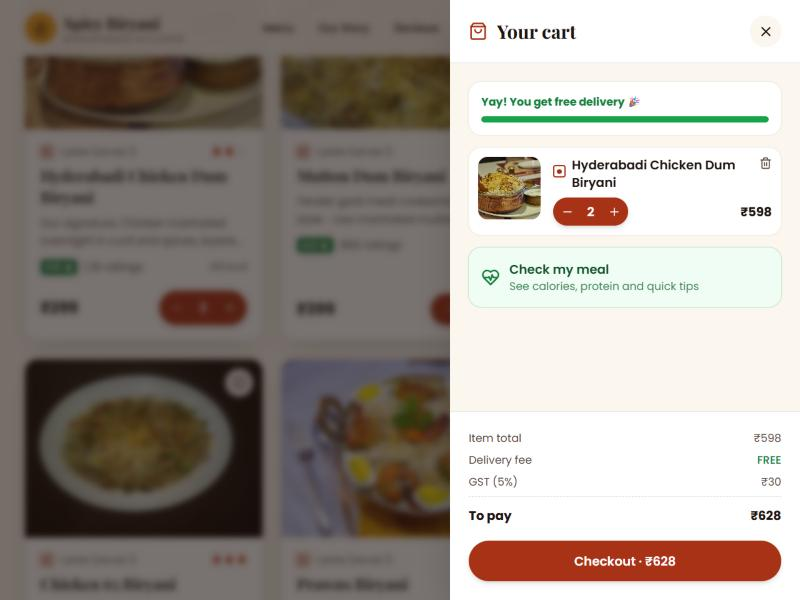
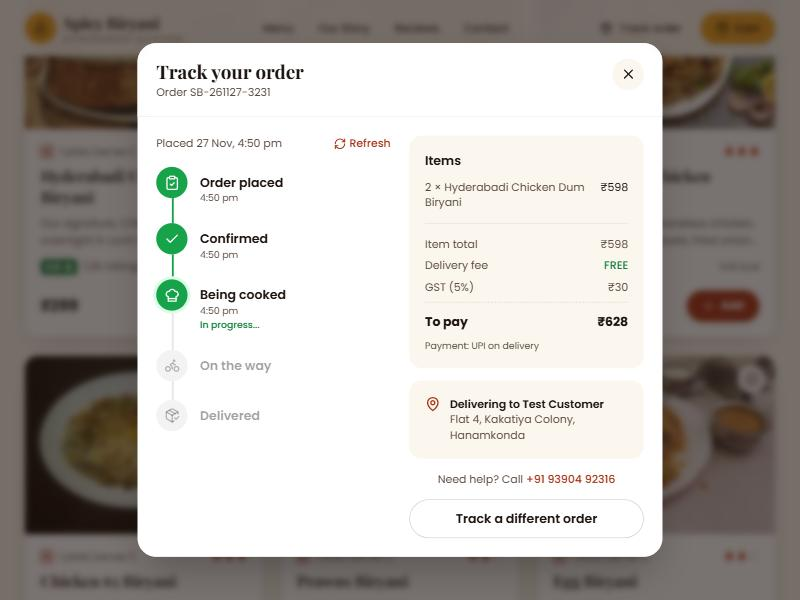
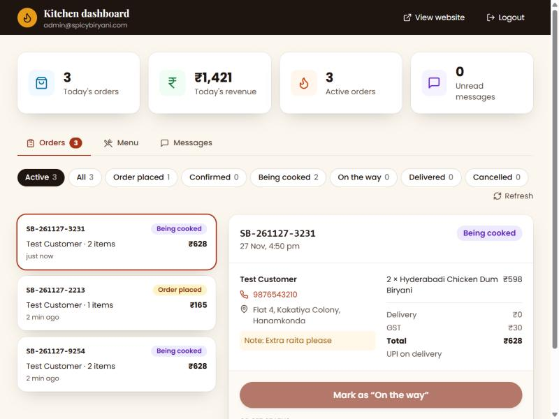
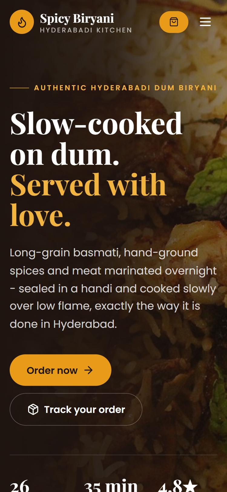

# 🍛 Spicy Biryani – Restaurant Ordering Website (MERN)

A full-stack food ordering website for a Hyderabadi biryani restaurant.
Customers can browse the menu, add dishes to a cart, place an order and track it live.
The restaurant staff get an admin dashboard to manage orders, the menu and customer messages.

**Tech stack:** MongoDB · Express · React (TypeScript) · Node.js · Tailwind CSS



| Menu | Cart with live bill |
|------|---------------------|
|  |  |

| Live order tracking | Admin dashboard |
|---------------------|-----------------|
|  |  |

<p align="center"><br><em>Works on phones too</em></p>

---

## ✨ Features

### For customers
- **Menu with 26 real dishes** – biryanis, starters, curries, breads, desserts and drinks, with real photos, prices, ratings and spice level
- **Search, category tabs and a "Veg only" filter**
- **Cart** that is saved in the browser (it is still there after a page refresh)
- **Live bill** – item total, delivery fee (free above ₹499) and 5% GST
- **Checkout form** with checks for name, 10-digit mobile number and address
- **Order tracking** – enter order number + phone number to see the order status. The page refreshes itself every 20 seconds
- **Nutrition info** for every dish, and a **"Check my meal"** button that adds up calories/protein for the whole cart and gives simple tips
- **Contact form** that saves messages to the database
- Works on mobile, tablet and desktop

### For the restaurant (Admin dashboard at `/admin`)
- **Secure login** with a hashed password and a JWT token
- **Today's numbers** – orders, revenue, active orders, unread messages
- **Orders** – filter by status, see full details, move an order to the next step (Confirmed → Being cooked → On the way → Delivered) or cancel it. New orders appear on their own every 15 seconds
- **Menu** – change prices and mark dishes as sold out
- **Messages** – read and delete contact form messages

---

## 📁 Folder structure

```
Spicy-Biryani-Restaurant-Website/
├── backend/                 → Express + MongoDB REST API (MVC pattern)
│   ├── config/              → database connection
│   ├── models/              → Mongoose schemas (MenuItem, Order, Admin, Message)
│   ├── controllers/         → the logic for each API
│   ├── routes/              → which URL calls which controller
│   ├── middleware/          → login check (JWT) and error handling
│   ├── utils/               → small helpers (bill calculation, order number, tips)
│   ├── seed/                → default menu data + seed script
│   └── server.js            → starts the server
│
└── frontend/                → React + TypeScript + Tailwind (Vite)
    └── src/
        ├── pages/           → HomePage and AdminPage
        ├── components/      → UI pieces (home, order, admin, layout, common)
        ├── context/         → Cart state shared by all components
        ├── hooks/           → useCart, useLockBodyScroll
        ├── services/api.ts  → every call to the backend lives here
        ├── data/            → restaurant details (address, hours, reviews)
        ├── types/           → TypeScript types
        └── utils/           → price/date helpers
```

More details: [backend/README.md](backend/README.md) and [frontend/README.md](frontend/README.md).

---

## 🚀 Run it on your computer

### What you need
- **Node.js 18 or newer** – check with `node -v`
- **MongoDB** – either installed on your computer, or a free cloud database from [MongoDB Atlas](https://www.mongodb.com/cloud/atlas)

### 1. Start the backend

```bash
cd backend
npm install
cp .env.example .env      # on Windows PowerShell: copy .env.example .env
```

Open `backend/.env` and set:
- `MONGO_URI` – your MongoDB connection string (from Atlas: **Connect → Drivers**)
- `JWT_SECRET` – any long random text
- `ADMIN_EMAIL` and `ADMIN_PASSWORD` – the login for the admin dashboard

```bash
npm run dev
```

You should see:

```
MongoDB connected: ...
Added 26 menu items
Admin account created for admin@spicybiryani.com
Server running on http://localhost:5000
```

The menu and admin account are added **automatically the first time** – you don't need to do anything else.

### 2. Start the frontend (in a second terminal)

```bash
cd frontend
npm install
npm run dev
```

Open **http://localhost:5173** for the website and **http://localhost:5173/admin** for the dashboard.

---

## 🔌 API at a glance

| Method | URL | Who | What it does |
|--------|-----|-----|--------------|
| GET | `/api/menu` | Public | Get all dishes (filters: `category`, `veg`, `search`) |
| GET | `/api/menu/:id` | Public | Get one dish |
| POST / PUT / DELETE | `/api/menu/:id` | Admin | Add, edit or delete a dish |
| POST | `/api/orders` | Public | Place an order |
| GET | `/api/orders/track/:orderNumber?phone=` | Public | Track an order |
| GET | `/api/orders` | Admin | List orders (filter by `status`, with pages) |
| GET | `/api/orders/stats` | Admin | Numbers for the dashboard |
| PATCH | `/api/orders/:id/status` | Admin | Change order status |
| POST | `/api/auth/login` | Public | Admin login → returns a JWT token |
| GET | `/api/auth/me` | Admin | Check who is logged in |
| POST | `/api/messages` | Public | Send a contact form message |
| GET / PATCH / DELETE | `/api/messages` | Admin | Read / mark as read / delete messages |
| POST | `/api/nutrition/analyze` | Public | Nutrition totals and tips for a cart |

Full request and response examples are in [backend/README.md](backend/README.md).

---

## 🧠 How it works (simple explanation)

**1. The customer opens the website.**
React loads and calls `GET /api/menu`. The backend reads the dishes from MongoDB and sends them back as JSON. React shows them as cards.

**2. The customer adds dishes to the cart.**
The cart is stored in React Context (so every component can see it) and also saved in `localStorage` (so it survives a refresh). No server call is needed for this.

**3. The customer places an order.**
The frontend sends only the **dish IDs and quantities** to `POST /api/orders`.
The backend looks up each dish in MongoDB and uses **the price from the database**, not a price from the browser. This stops anyone from changing the price in the browser and paying less.
Then it adds delivery and GST, creates an order number like `SB-251127-4821` and saves the order.

**4. The customer tracks the order.**
They enter the order number **and** their phone number. Both must match, so a stranger can't look at someone else's order and address.

**5. The admin logs in.**
The password is stored as a **bcrypt hash** (never the real password). After a correct login the server gives a **JWT token**. The browser sends this token with every admin request, and the `protect` middleware checks it before allowing access.

**6. The admin updates the status.**
`PATCH /api/orders/:id/status` saves the new status and also the time it changed (`statusHistory`). The customer's tracking screen picks this up on its next refresh.

---

## ⚡ What makes it fast

- **gzip compression** on every API response (`compression` middleware)
- **Database indexes** on the fields we search by (order number, status, category)
- **`.lean()` queries** – Mongoose returns plain objects, which is quicker
- **Menu response is cached** by the browser for 60 seconds
- **The admin page is a separate file** (`React.lazy`) – customers never download it
- **React is split into its own file** so browsers keep it cached between visits
- **Images load lazily** – photos further down the page load only when you scroll to them
- **Preconnect + preload** in `index.html` so fonts and the hero photo start loading straight away

---

## 🗣️ Explaining this project (interview notes)

**"Tell me about this project."**
> It's a MERN food ordering website for a biryani restaurant. Customers can browse the menu, order and track their order. The owner has an admin dashboard to manage orders and the menu. The backend is an Express REST API with MongoDB, written in MVC style, and the frontend is React with TypeScript and Tailwind.

**"What is MVC here?"**
> Model = the Mongoose schema (how data looks in MongoDB). Controller = the function that does the work, like creating an order. Routes connect a URL to a controller. It keeps each file small and easy to find.

**"How does login work?"**
> The admin password is hashed with bcrypt. On login I compare the typed password with the hash. If it matches, I create a JWT token with the admin's ID and send it back. The frontend saves it and sends it in the `Authorization` header. A middleware checks the token on every admin route.

**"How did you stop people from changing prices?"**
> The frontend only sends item IDs and quantities. The backend fetches the real prices from MongoDB and calculates the bill itself.

**"How do updates show without refreshing?"**
> Polling – the tracking screen asks the server for the latest status every 20 seconds, and the admin screen every 15 seconds. It's simple and good enough for a small restaurant. For a bigger app I would use WebSockets (Socket.io).

**"How do you handle errors?"**
> Every controller passes errors to one error middleware, which sends a clean JSON message with the right status code (400 for bad input, 401 for not logged in, 404 for not found). On the frontend, `services/api.ts` turns these into readable messages shown in the UI.

**"What would you add next?"**
> Online payment (Razorpay), SMS/email when the status changes, customer accounts with order history, and Socket.io for instant updates.

---

## ☁️ Deploying (optional)

- **Database:** MongoDB Atlas (free tier)
- **Backend:** Render / Railway – set the same variables as in `.env`, and set `CLIENT_URL` to your frontend URL
- **Frontend:** Vercel / Netlify – set `VITE_API_URL` to `https://<your-backend>/api`, build command `npm run build`, output folder `dist`

---

## 🙏 Credits

Food photos are from [Wikimedia Commons](https://commons.wikimedia.org) and are shared under Creative Commons licences by their authors.
The customer reviews on the home page are sample text for the demo.
